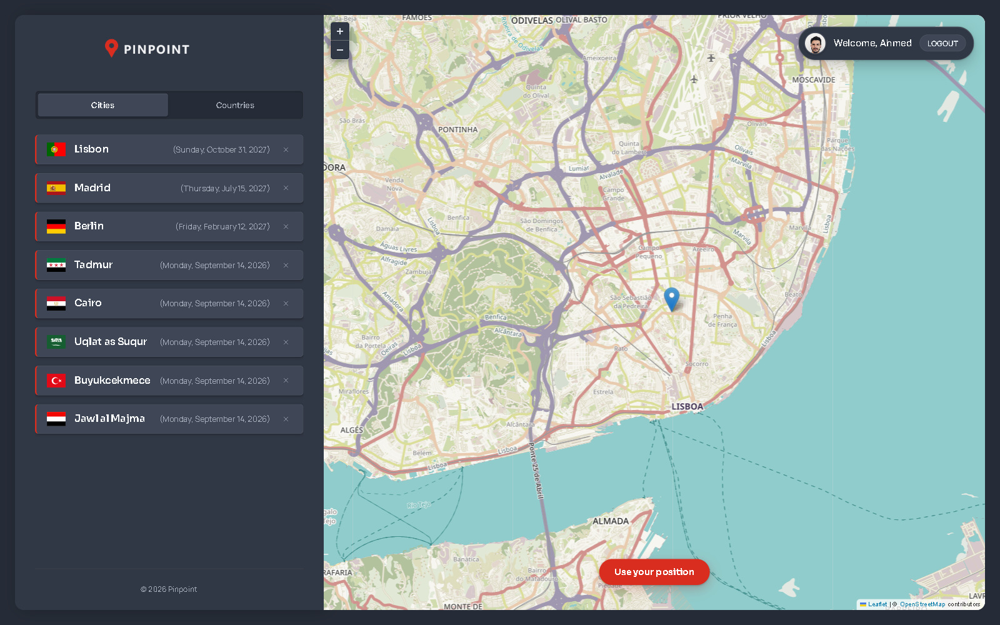
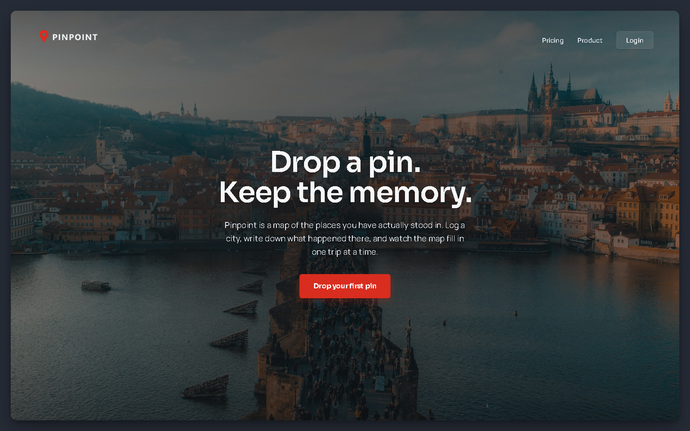
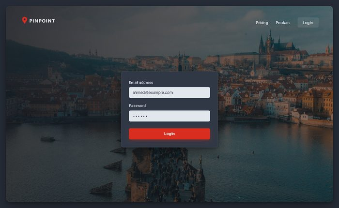
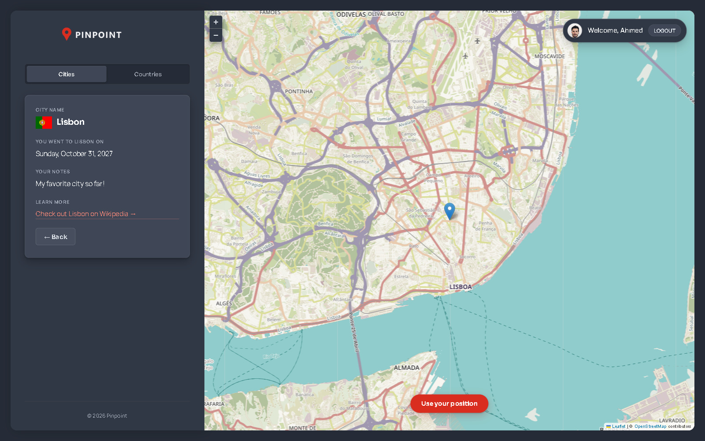
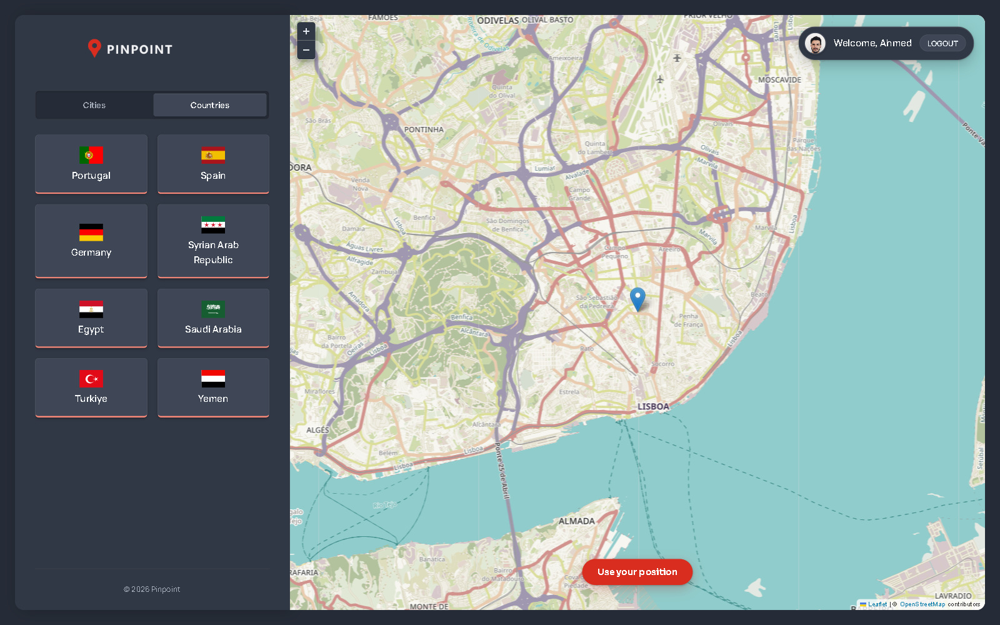

# Pinpoint

Pinpoint is a travel app. You click a place on a world map, and the app saves
that city to your list. You can add the date you went there and a short note.
Cities are also grouped by country, so you can see every country you have
visited.



This is a demo app. It runs on a local fake API, so there is no hosted link.
The instructions below start it in about one minute.

---

## What it does

- Click anywhere on the map to add a city
- The app reads the coordinates and fills in the city and country for you
- Save a date and your own notes for each city
- See all your cities in a list, or grouped by country
- Delete a city from the list
- Click "Use your position" to jump the map to where you are
- Log in and log out (fake auth, see the note below)

---

## How to run it

You need Node.js. The app needs two terminals, because the data comes from a
local API.

```bash
npm install
```

**Terminal 1** — the fake API:

```bash
npm run server
```

**Terminal 2** — the app:

```bash
npm run dev
```

Open the address that Vite prints, usually `http://localhost:5173`.

To log in, use the email and password that are already filled in the form.

---

## Tech stack

| What | Why |
| --- | --- |
| React 18 | The whole UI |
| React Router 6 | Pages, nested routes, URL parameters |
| Context + `useReducer` | Shared state for cities and for auth |
| Leaflet | The map |
| json-server | A fake REST API, so the app talks to a real endpoint |
| CSS Modules | Styles, with no CSS framework |
| `lazy` + `Suspense` | Code splitting, one chunk per page |
| Vite | Dev server and build |

---

## How the state works

This is the part I spent the most time on, so I want to explain it properly.

### Why `useReducer` and not `useState`

The cities data has four values that always change together:

```js
const initialState = {
  cities: [],
  loading: false,
  currentCity: {},
  error: "",
};
```

Every action touches more than one of them at the same time. When a fetch
starts, `loading` becomes `true`. When it finishes, `loading` goes back to
`false` **and** `cities` gets the new data. When it fails, `loading` goes back
to `false` **and** `error` gets a message.

With `useState` this would be three or four `set` calls in a row, in every
function, and it is easy to forget one. With `useReducer` each case describes
one complete change:

```js
case "cities/loaded":
  return { ...state, loading: false, cities: action.payload };

case "rejected":
  return { ...state, loading: false, error: action.payload };
```

Now every state change lives in one file and I can read all of them in one
place.

### Why the reducer never fetches

The reducer is a pure function. It only takes the old state and an action, and
returns the new state. The `fetch` calls happen in the provider, and only the
result is sent to the reducer:

```js
async function getCity(id) {
  dispatch({ type: "loading" });
  const res = await fetch(`${BASE_URL}/cities/${id}`);
  const data = await res.json();
  dispatch({ type: "city/loaded", payload: data });
}
```

This keeps the reducer easy to follow. Same action in, same state out, always.

### Two contexts, not one

There are two separate providers:

- `CitiesContext` — the cities, the current city, loading and error
- `FakeAuthContext` — the user and whether they are logged in

They change at completely different times. Logging in should not make the city
list re-render, and loading a city has nothing to do with the user. Keeping
them apart also made each file much shorter.

### The protected route

`/app` and everything under it should only work when you are logged in. That
check is one small component:

```jsx
function ProtectedRoute({ children }) {
  const { isAuthenticated } = useAuth();
  const navigate = useNavigate();

  useEffect(
    function () {
      if (!isAuthenticated) navigate("/");
    },
    [isAuthenticated, navigate],
  );

  return isAuthenticated ? children : null;
}
```

It sends you back to the homepage if you are not logged in, and returns `null`
in the meantime so nothing flashes on the screen first.

---

## Custom hooks

Two small hooks, each doing one job.

**`useUrlPosition`** reads the latitude and longitude out of the URL:

```js
const [lat, lng] = useUrlPosition();
```

The map position lives in the URL (`/app/form?lat=38.7&lng=-9.1`). That means
you can copy the link, send it to someone, and they see the same place. It
also means the form and the map can both read the position without passing
props between them.

**`useGeolocation`** wraps the browser geolocation API. It returns the
position, a loading flag, an error, and the `getPosition` function that starts
the request.

---

## Routing

React Router does more here than just show pages. The app uses nested routes,
so the sidebar stays on screen and only its content changes:

```jsx
<Route path="app" element={<ProtectedRoute><AppLayout /></ProtectedRoute>}>
  <Route index element={<Navigate replace to="cities" />} />
  <Route path="cities" element={<CityList />} />
  <Route path="cities/:id" element={<City />} />
  <Route path="countries" element={<CountryList />} />
  <Route path="form" element={<Form />} />
</Route>
```

The `<Outlet />` sits inside `Sidebar`, so the child route renders in the left
panel while the map stays mounted on the right. That matters: the map keeps
its zoom and position when you move between Cities, Countries and the form.
The `index` route redirects `/app` to `/app/cities`, so the app never opens on
an empty panel.

---

## Code splitting

Every page is loaded with `lazy` and wrapped in one `Suspense` boundary:

```jsx
const Homepage = lazy(() => import("./pages/Homepage"));
const AppLayout = lazy(() => import("./pages/AppLayout"));

<Suspense fallback={<SpinnerFullPage />}>
  <Routes>...</Routes>
</Suspense>
```

This matters here because of Leaflet. The map is the biggest dependency in the
project, and someone who only opens the landing page should not have to
download it. After the change the build output is split up:

```
index.js       363 kB   the shell, the router, the contexts
AppLayout.js   157 kB   the map, loaded only when you open /app
Login.js         1 kB
Product.js       1 kB
```

Before, all of this was one 522 kB file that every visitor downloaded.

---

## Screens

The landing page:



Signing in:



One city, with the date and the notes I saved:



The same cities grouped by country:



---

## Project structure

```
src/
├── App.jsx                    all the routes
├── index.css                  design tokens, resets, global styles
├── components/
│   ├── ProtectedRoute.jsx     the protected route wrapper
│   ├── CityItem.jsx           one row in the sidebar list
│   ├── CityList.jsx           the list of saved cities
│   ├── City.jsx               details for one city
│   ├── CountryList.jsx        cities grouped by country
│   ├── Form.jsx               add a new city
│   ├── Map.jsx                the Leaflet map
│   └── Sidebar.jsx            the left panel
├── contexts/
│   ├── CitiesContext.jsx      useReducer + fetching
│   └── FakeAuthContext.jsx    login state
├── hooks/
│   ├── useGeolocation.js
│   └── useUrlPosition.js
└── pages/
    ├── AppLayout.jsx           the sidebar + map shell
    ├── Homepage.jsx
    ├── Login.jsx
    ├── PageNotFound.jsx
    ├── Pricing.jsx
    └── Product.jsx
```

---

## What I learned

Before this project I knew what `useReducer` was, but I had only used it on
small examples. Here I learned when it is actually better than `useState`:
when several pieces of state change together, and when the same change is
triggered from more than one place.

The second thing was dependency arrays. React compares them by identity, not
by value, so a function written inside a component is a brand new value on
every render. Put one in a dependency array without `useCallback` and the
effect can run again and again. That was not obvious to me, and working it out
taught me more than the feature itself did.

---

Map data from OpenStreetMap. Photos from Unsplash.
